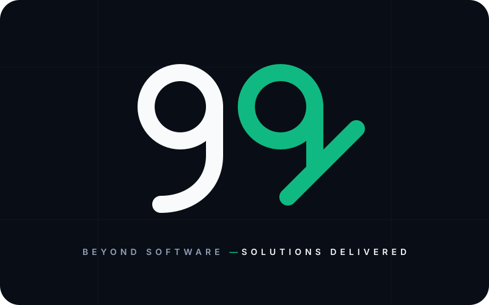

# 99 — Brand Logo

**99** does not just develop software — **it delivers solutions**.

## Design Concept

The minimal geometric mark pairs two `9`s to tell a two-part story:
1. **First `9` (Software Architecture):** A clean, structural monoline `9` in high-contrast slate/white representing solid engineering foundations.
2. **Second `9` (Delivered Solution):** A matching `9` in emerald (`#10B981`) whose tail pivots upward into a crisp checkmark / forward vector — symbolizing completion, outcomes, and delivered solutions.

## Assets

- [`logo.svg`](./logo.svg) — Primary lockup on dark background with tagline (`BEYOND SOFTWARE — SOLUTIONS DELIVERED`)
- [`logo-mark.svg`](./logo-mark.svg) — Transparent standalone logomark

