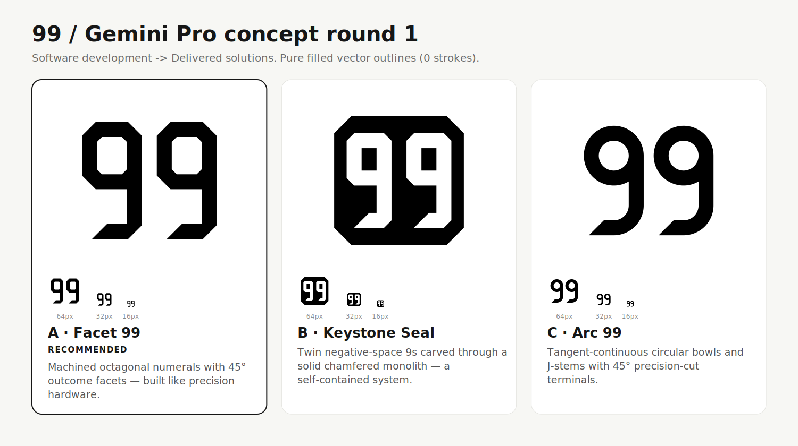

# 99 — Gemini Pro Concept Round 1

## Brief & Positioning
**99** is a software development company that does not merely write code — it **delivers complete solutions**.
Following the `logo-design` skill workflow, these three directions avoid literal category clichés (`< >` brackets, cogs, checkmarks, arrows) and instead express **engineered precision, structural completion, and self-contained delivery** through pure filled-outline vector geometry (`0` strokes, `0` live text, `100/100` heuristic audit score across all three files).

## The Three Directions

### A · Facet 99 (Recommended) — Custom Architectural Numeral Mark
- **File:** [`concepts/a-facet-99.svg`](./concepts/a-facet-99.svg)
- **Idea:** Machined octagonal numerals whose descending stems resolve into 45° precision-cut horizontal footings — engineered like industrial hardware rather than set in a stock font.
- **Why it fits:** High-contrast, authoritative, and unmistakable at `64px`, `32px`, and `16px`.
- **Honest risk:** The chamfered industrial geometry leans bold and technical; if a softer editorial tone is desired, **C** is warmer.

### B · Keystone Seal — Negative-Space Monolith Emblem
- **File:** [`concepts/b-keystone-seal.svg`](./concepts/b-keystone-seal.svg)
- **Idea:** Twin negative-space `9`s carved through a solid 45°-chamfered monolith — a self-contained, shipped system.
- **Why it fits:** Works immediately as a standalone app tile, GitHub org avatar, or stamped seal on dark and light surfaces without needing an extra container.
- **Honest risk:** Heavy black mass needs slight optical thinning when reversed white-on-black at `16px`.

### C · Arc 99 — Tangent-Continuous Geometric Wordmark
- **File:** [`concepts/c-tangent-99.svg`](./concepts/c-tangent-99.svg)
- **Idea:** True circular bowls ($R=48, r=24$) transitioning tangentially into vertical stems and concentric $J$-hooks, finished with 45° precision-cut terminals.
- **Why it fits:** Balances Swiss geometric warmth (circular counters) with engineered discipline (45° terminal cuts) and stays completely open at `16px`.
- **Honest risk:** More understated than **A** or **B**; relies on proportion and the 45° terminal cut for ownership.

## Verification & Audit (`svg_audit.py`)
- `a-facet-99.svg`: `viewBox 0 0 256 256`, 1 colour (`#000000`), margins `L20 R20 T34 B34`, `0` warnings/issues (`100/100`).
- `b-keystone-seal.svg`: `viewBox 0 0 256 256`, 1 colour (`#000000`), margins `L24 R24 T24 B24`, `0` warnings/issues (`100/100`).
- `c-tangent-99.svg`: `viewBox 0 0 256 256`, 1 colour (`#000000`), margins `L24.2 R24.0 T40 B40`, `0` warnings/issues (`100/100`).

