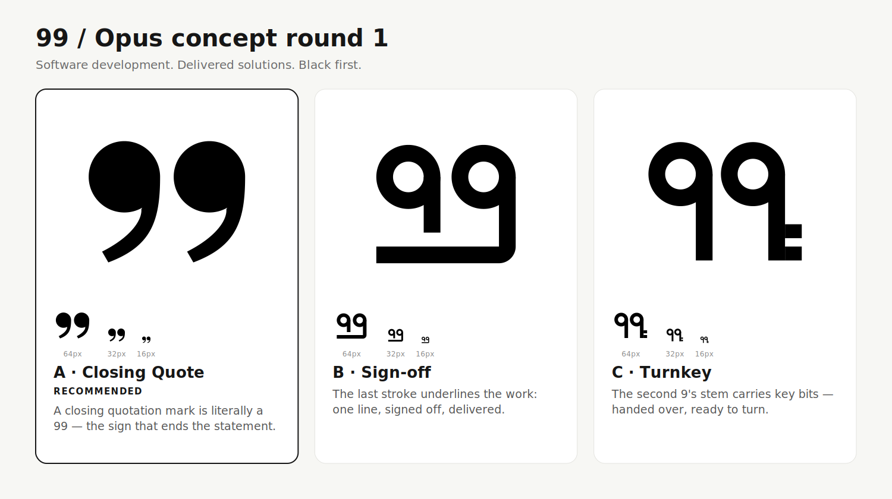

# 99 — Opus concept round 1

Made directly by Claude Opus in this session, following the installed `logo-design` skill (phases 1–6).
Stopped at the concept checkpoint: no colour, kit or brand book yet.

| File | What |
|---|---|
| `brief.md` | Brief, the insight, clichés off limits, name-adjacent marks |
| `longlist.md` | 11 scored ideas → 3 built |
| `concepts/*.svg` | Final masters (filled paths only; no strokes, text, rasters, filters) |
| `revisions/*-v1…v4.svg` | Every saved iteration |
| `renders/inspect-v1…v3.png` | What was looked at between iterations |
| `checks/` | 16/32/64 px black + reversed PNGs, `size-reverse-ladder.png`, `svg-audit.txt` |
| `build.py` | Reproducible geometry: `python3 build.py 4` |

## Directions

**A · Closing Quote — recommended** (`a-closing-quote.svg`, typographic sign)
Typographers call quotation marks "66 … 99": the *closing* mark is literally a 99. It ends the statement —
the brief has been heard and the thing is delivered. The name *is* the symbol, so no "symbol + 99" redundancy.
Strongest of the three at 16 px. **Risk:** a quotation mark is a common glyph (quotes, testimonials,
comms brands); ownership must come from custom drawing and consistent use, and a trademark search matters most here.

**B · Sign-off** (`b-sign-off.svg`, custom wordmark)
The second 9's stem turns on one radius into a single line under both numerals: the work underlined, signed off.
**Risk:** an underlined number can read as a hyperlink or "emphasis" rather than delivery.

**C · Turnkey** (`c-turnkey.svg`, pictorial letterform)
The second 9's stem carries two key bits — handed over, ready to turn. Most literal of the three.
**Risk:** the bits blur to a notch below 32 px; it would need a small-size cut.

## Refinement record (actually viewed)
- **v1 → v2:** A's tail left a dent on the disc and the pair sat off-centre. B's opening on the left of the first loop
  read as a **3** ("39"). C's key bits were too timid to read. → A tail joined flush and centred; B opening moved;
  C bits enlarged, mark centred.
- **v2 → v3:** B still read as a broken / reversed numeral at a glance — the open-loop idea was dropped and replaced
  with **Sign-off**. A tail cut snapped to an exact 120° edge.
- **v3 → v4:** A occupied only 40 % of its canvas and was weakest at 16 px → scaled 1.22× about centre (fill 0.60).

## Checks run
- `svg_audit.py` on the three finals: **no warnings, no FAILs**, 100/100 heuristic each (`checks/svg-audit.txt`).
  This is a structural check — not a measure of aesthetic quality or originality.
- 16/32/64 px, black on white and white on black, rendered with CairoSVG and inspected (`checks/size-reverse-ladder.png`).
  All three hold at 16 px; C's key bits reduce to a notch. Reversed versions use the same geometry — no optical
  thinning applied yet.
- No browser was used. No trademark clearance: [99x](https://99x.io/) and [99designs](https://99designs.com/)
  are name-adjacent; a professional search is required before adoption.
